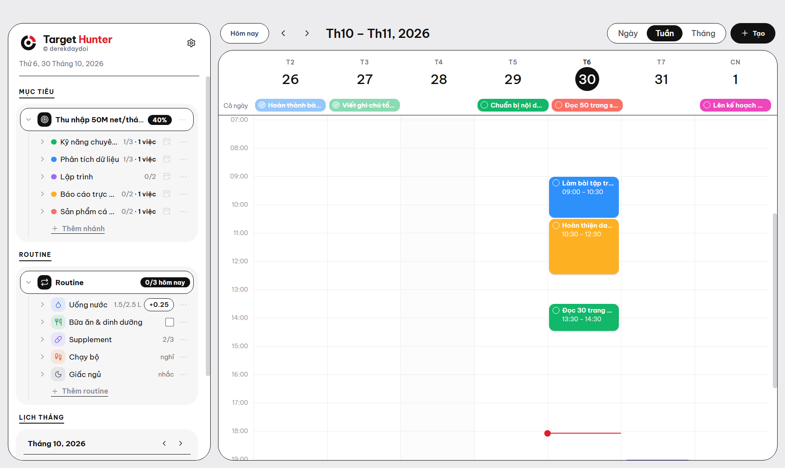
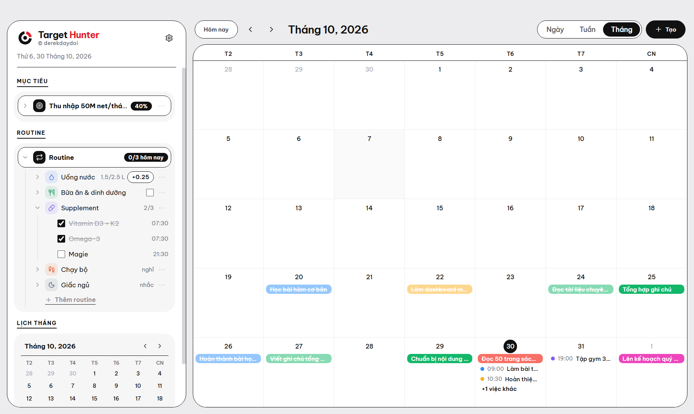
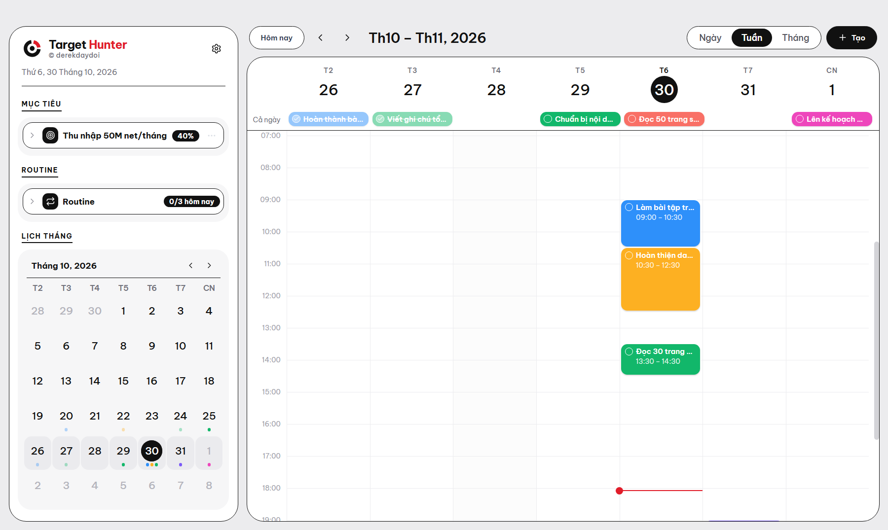

<p align="center">
  
</p>

<p align="center">
  Ứng dụng desktop cá nhân cho Windows: cây mục tiêu và routine bên cạnh một cuốn lịch,<br>
  để việc hằng ngày luôn nối với đích dài hạn.
</p>

<p align="center">
  <a href="https://github.com/derekdaydoi/Target_Hunter/releases/latest/download/TargetHunter-Setup.exe">
    
  </a>
</p>

<p align="center"><sub>TargetHunter-Setup.exe · 64-bit · khoảng 119 MB</sub></p>

---

## Ảnh demo

<sub>Chụp từ dữ liệu mẫu có sẵn khi mở app lần đầu (nhân vật "Alex"), không phải dữ liệu của người thật.</sub>



| Lịch tháng | Lịch tháng nhỏ tự co giãn |
|---|---|
|  |  |

## Tính năng

- **Một màn hình, hai phần.** Bên trái là cây mục tiêu, cây routine và lịch tháng nhỏ. Bên phải là lịch lớn. Không có menu, không có trang phụ.
- **Cây mục tiêu:** Mục tiêu chính → Nhánh → Mốc. Thêm mốc ngay trên cây (gõ rồi Enter), bấm đúp để đổi tên, tick để hoàn thành. Nút lịch trên mỗi nhánh thêm việc vào lịch, gắn sẵn với nhánh đó.
- **Mục tiêu chính** đo bằng một con số (kèm tốc độ tăng trưởng cần đạt mỗi năm), hoặc bằng các nhánh: xong các nhánh là xong mục tiêu.
- **Cây routine:** từng routine và từng lần trong ngày. Mỗi routine chọn một cách theo dõi: chỉ nhắc, tick mỗi ngày, tick theo giờ (ví dụ 07:30 Vitamin D3), đếm theo ngày (ví dụ 2.5 L nước) hoặc theo lịch (chạy bộ T3 · T5 · CN). App chỉ nhắc khi hôm nay chưa giữ.
- **Lịch kiểu Google Calendar:**
  - Chế độ ngày và tuần có lưới giờ, việc là khối màu đặt đúng giờ, việc trùng giờ nằm cạnh nhau, có vạch đỏ chỉ giờ hiện tại.
  - Chế độ tháng: việc cả ngày là khối màu, việc có giờ hiện chấm màu kèm giờ.
  - Bấm ô trống để tạo việc đúng giờ đó, bấm khối để sửa, bấm vòng tròn trên khối để đánh dấu xong.
- **Lịch tháng nhỏ** dưới cây routine tự co giãn: cây ngắn thì lịch to ra, cây dài thì lịch thu nhỏ. Mỗi việc là một chấm màu. Bấm một ngày thì lịch lớn nhảy tới ngày đó.
- **Kỷ luật:** việc có giờ phải xong trong ngày; việc chỉ có ngày được linh động đến hết Chủ nhật tuần đó. Dời qua hạn sẽ được ghi lại.
- **Nhắc việc** theo giờ khi app đang mở.
- **Dữ liệu của bạn:** lưu trên máy bằng SQLite, không cần tài khoản hay internet. Sao lưu, xuất/nhập JSON và xuất CSV trong **Cài đặt** (nút bánh răng cạnh logo).

## Cài đặt

1. Bấm **Tải về** ở trên để tải `TargetHunter-Setup.exe`.
2. Chạy file. App tự cài và tạo lối tắt **Target Hunter** trên Desktop và Start Menu.

Installer chưa ký số nên Windows SmartScreen có thể cảnh báo: chọn **More info → Run anyway**.

Lần mở đầu tiên app có sẵn **dữ liệu mẫu** để bạn xem cách dùng. Sửa trực tiếp trên cây, hoặc xoá hết tại **Cài đặt → Xoá toàn bộ dữ liệu** rồi nhập của bạn. Dữ liệu chỉ nằm trên máy, ở `%APPDATA%\DerekOS\derekos.sqlite`.

## Chạy từ mã nguồn

Cần Node.js 20 trở lên.

```bash
npm install
npm start        # build giao diện rồi mở app
npm run dist     # tạo installer trong release/
```

Lưu ý khi build trên Windows:

- Đặt dự án ở đường dẫn ngắn (ví dụ `C:\dev\target-hunter`); đường dẫn quá dài làm bước tạo installer lỗi.
- Nếu `npm run dist` báo lỗi `EPERM` hoặc dừng ở bước tạo installer, thường do antivirus đang quét thư mục vừa giải nén: chạy lại lệnh.
- Nếu `npm start` không mở cửa sổ, bỏ biến môi trường `ELECTRON_RUN_AS_NODE`.

## Cấu trúc

```
electron/      main process: SQLite (sql.js), IPC, nhắc việc, cửa sổ
src/           giao diện React + TypeScript
  lib.ts         kiểu dữ liệu, ngày tháng, tính tiến độ
  store.tsx      trạng thái dùng chung, đọc/ghi dữ liệu
  ui.tsx         thành phần dùng lại (cửa sổ sửa việc, logo)
  styles.css     style nền và các form
  home.css       style của màn hình chính: cây, lịch, lịch tháng nhỏ
  pages/
    Home.tsx       màn hình chính: cây mục tiêu, cây routine, lịch tháng nhỏ
    Calendar.tsx   lịch lớn: ngày, tuần, tháng
    Dashboard, Insight, Frames, Work, Chart: các form và phần dùng lại
scripts/       sinh logo và icon
logo/          bộ logo
docs/          ảnh demo
```

Electron, React, TypeScript, Vite, sql.js, electron-builder. Font Be Vietnam Pro đóng gói kèm.

© derekdaydoi
