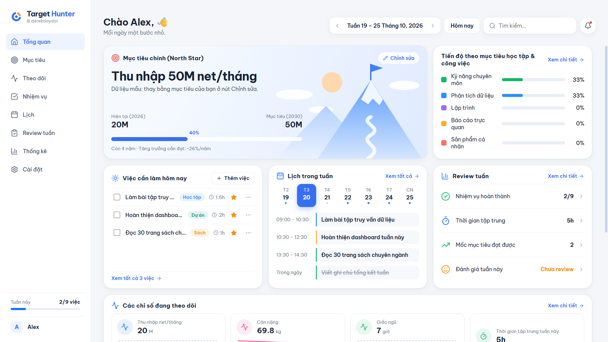
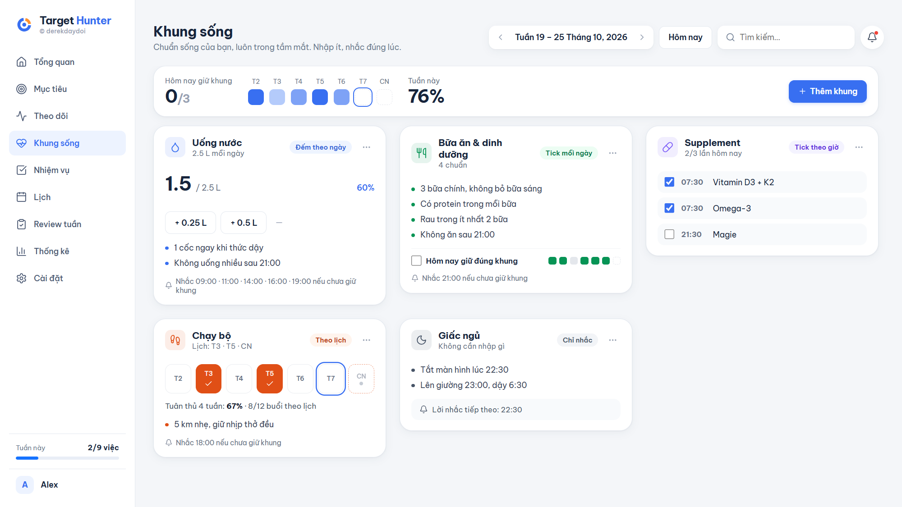
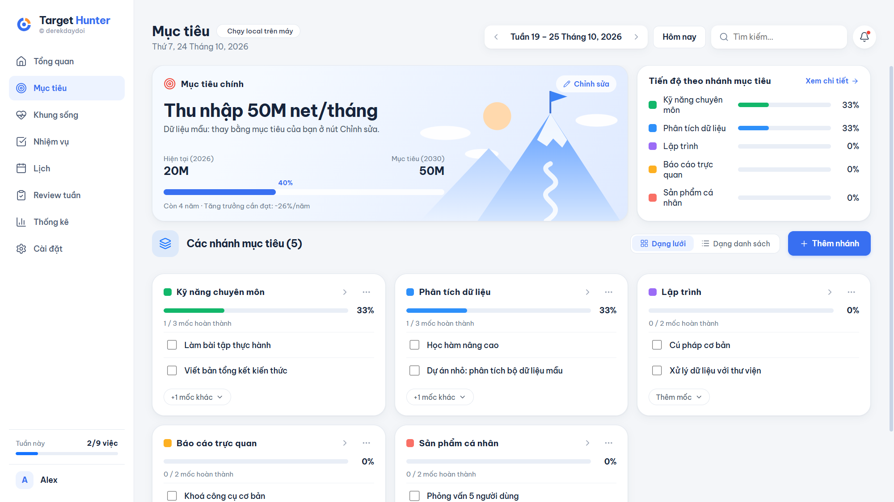
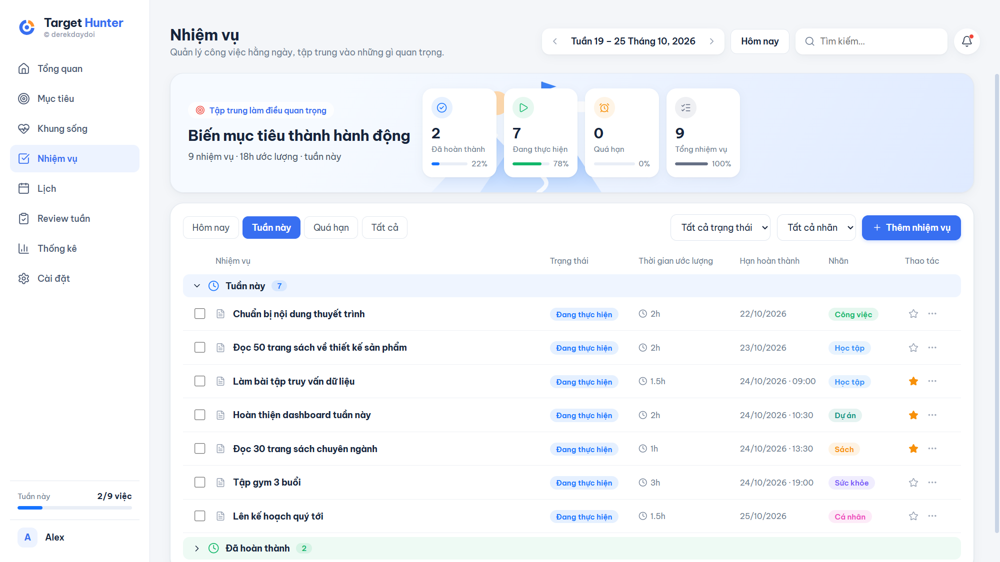
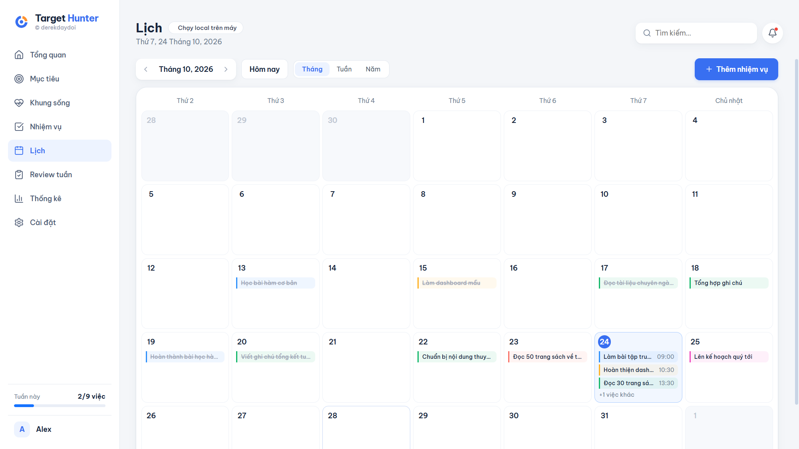
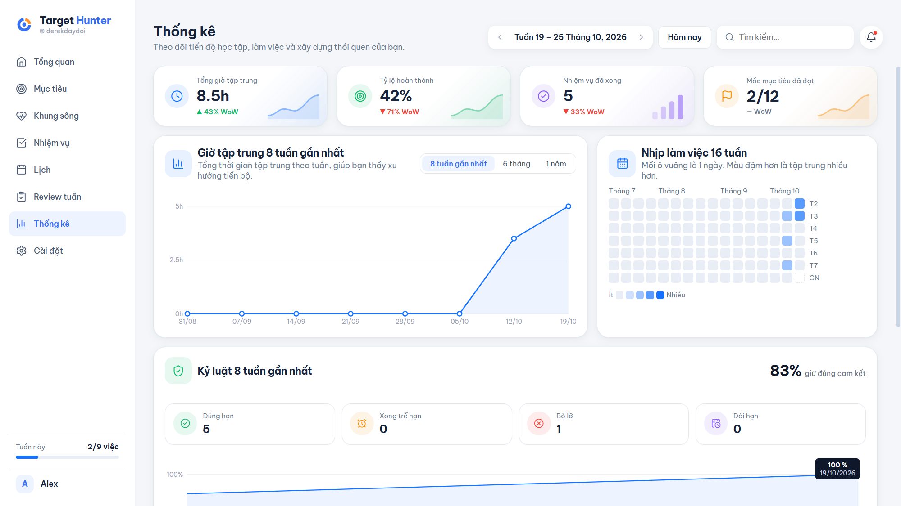
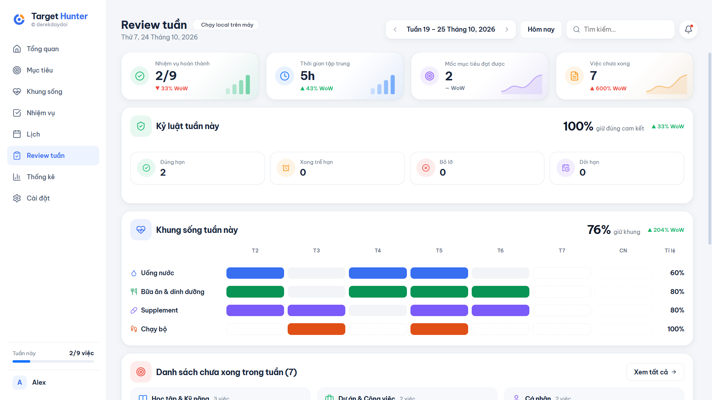

<p align="center">
  
</p>

<p align="center">
  Ứng dụng desktop local-first cho Windows: nối việc hằng ngày với mục tiêu dài hạn,<br>
  để học và làm luôn ra đầu ra phục vụ đích.
</p>

<p align="center">
  <a href="https://github.com/derekdaydoi/Target_Hunter/releases/latest/download/TargetHunter-Setup.exe">
    
  </a>
</p>

<p align="center"><sub>TargetHunter-Setup.exe · 64-bit · khoảng 113 MB · <a href="https://github.com/derekdaydoi/Target_Hunter/releases/latest">Các phiên bản</a></sub></p>

---

## Ảnh demo

<sub>Chụp từ dữ liệu mẫu có sẵn khi mở app lần đầu (nhân vật "Alex"), không phải dữ liệu của người thật.</sub>

| Tổng quan | Khung sống |
|---|---|
|  |  |

| Mục tiêu | Nhiệm vụ |
|---|---|
|  |  |

| Lịch | Thống kê |
|---|---|
|  |  |

| Review tuần |
|---|
|  |

## Tính năng

- **Một màn hình, hai phần**: bên trái là cây mục tiêu và routine (Mục tiêu chính → Nhánh → Mốc; Routine → từng routine → từng lần trong ngày), tự thêm, đổi tên (bấm đúp), tick và xoá ngay trên cây; bên phải là lịch tháng/tuần/năm. Theme đen đỏ.
- **Mục tiêu chính**: đo bằng một con số (kèm tốc độ tăng trưởng cần đạt mỗi năm), hoặc gắn với các nhánh mục tiêu, ví dụ một giai đoạn "Phase 1: Data skills + Trading basic": xong các nhánh là xong mục tiêu.
- **Nhánh mục tiêu và mốc**: chia mục tiêu lớn thành các nhánh; mỗi nhánh gồm các mốc đầu ra cụ thể. Tiến độ bằng số mốc đã hoàn thành.
- **Khung sống**: chuẩn sống bạn muốn giữ (ăn uống, nước, supplement, vận động, giấc ngủ…), mỗi khung chọn cách theo dõi: chỉ nhắc, tick mỗi ngày, tick theo giờ, đếm theo ngày, hoặc theo lịch (chạy, cầu lông: đo tỉ lệ tuân thủ lịch, không đặt mục tiêu số buổi). App chỉ nhắc khi hôm nay chưa giữ khung.
- **Nhiệm vụ**: bảng theo nhóm (quá hạn, tuần này, sắp tới, đã xong), lọc theo trạng thái và nhãn. Tối đa 3 việc ưu tiên mỗi ngày.
- **Kỷ luật**: việc có giờ bắt đầu phải xong trong ngày; việc chỉ có ngày được linh động đến hết Chủ nhật tuần đó. Xong trễ, bỏ lỡ hay dời qua hạn đều được ghi lại để báo cáo.
- **Lịch**: xem theo tháng, tuần hoặc năm; nhắc việc theo giờ khi app đang mở.
- **Review tuần**: số liệu tự tính kèm thay đổi so với tuần trước (WoW), tỉ lệ giữ đúng cam kết và danh sách từng lần trễ/bỏ lỡ/dời hạn, bảng giữ khung sống theo ngày, việc chưa xong theo nhóm, ba câu tự đánh giá.
- **Thống kê**: giờ tập trung theo tuần, bản đồ nhịp làm việc 16 tuần, kỷ luật theo tuần, tiến độ từng nhánh.
- **Dữ liệu của bạn**: lưu cục bộ bằng SQLite, không cần tài khoản hay internet; sao lưu, xuất/nhập JSON, xuất CSV.

## Cài đặt

1. Bấm **Download** ở trên để tải `TargetHunter-Setup.exe`.
2. Chạy file. App tự cài và tạo lối tắt **Target Hunter** trên Desktop và Start Menu.

Installer chưa ký số nên Windows SmartScreen có thể cảnh báo: chọn **More info → Run anyway**.

Lần mở đầu tiên app có sẵn **dữ liệu mẫu** (nhân vật "Alex": mục tiêu, nhánh, mốc, nhiệm vụ, khung sống) để bạn xem cách dùng. Bấm **Chỉnh sửa** ở mục tiêu chính và sửa trực tiếp, hoặc xoá hết tại **Cài đặt → Xoá toàn bộ dữ liệu** rồi nhập của bạn. Dữ liệu của bạn chỉ nằm trên máy, ở `%APPDATA%DerekOSderekos.sqlite` (giữ tên cũ để bản cập nhật không làm mất dữ liệu).

## Chạy từ mã nguồn

Cần Node.js 20 trở lên.

```bash
npm install
npm start        # build giao diện rồi mở app
npm run dist     # tạo installer trong release/
```

Lưu ý khi build trên Windows:

- Đặt dự án ở đường dẫn ngắn (ví dụ `C:\dev\target-hunter`); đường dẫn quá dài làm bước tạo installer lỗi.
- Nếu `npm run dist` báo `EPERM ... rename ... .tmp`, thường do antivirus đang quét thư mục vừa giải nén: chạy lại lệnh.
- Nếu `npm start` không mở cửa sổ, bỏ biến môi trường `ELECTRON_RUN_AS_NODE`.

## Cấu trúc

```
electron/      main process: SQLite (sql.js), IPC, nhắc việc, cửa sổ
src/           giao diện React + TypeScript
  lib.ts         kiểu dữ liệu, ngày tháng, tính tiến độ
  store.tsx      trạng thái dùng chung, đọc/ghi dữ liệu
  ui.tsx         thành phần dùng lại (thẻ, cửa sổ, logo)
  styles.css     toàn bộ style
  pages/         Home (màn hình chính: cây + lịch), Dashboard, Insight (Mục tiêu, Thống kê, Review, Cài đặt), Work (Nhiệm vụ, Lịch), Frames (Khung sống), Chart (biểu đồ)
scripts/       sinh logo và icon
logo/          bộ logo
docs/          ảnh demo
```

Electron, React, TypeScript, Vite, sql.js, electron-builder. Font Be Vietnam Pro đóng gói kèm.

© derekdaydoi
